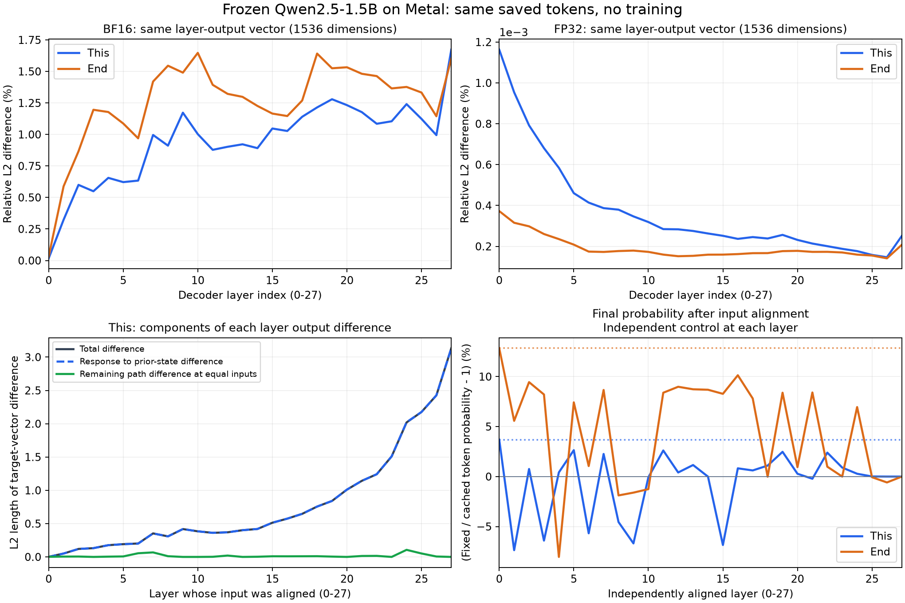

# 本地 Metal：小的计算差异如何传到最终 token 概率

2026-10-11。本轮使用本地 MPS，**没有提交 Setonix 作业，没有训练或更新参数**。完整模型的最终检查一轮用时 49.18 秒，40/40 项检查通过。这表示实验设置与记录通过检查，不表示有无 cache 的结果相等。

## 1. 一个模型，两种计算方式

使用冻结的原始 **Qwen2.5-1.5B-Instruct**，revision `989aa7980e4cf806f80c7fef2b1adb7bc71aa306`。没有插入 GeoRA 或 LoRA；KV cache 是 Transformers 原生 `DynamicCache`。

复用 [此前报告](reports/cached_logits/50659217.json) 中已经生成的八段回答，本轮不重新随机生成。两种方式都沿同一串 token 计算：

| 比较项 | 有 KV cache | 无 KV cache |
|---|---|---|
| 前文 | 同一问题、聊天模板和已生成的 token | 完全相同的有效前文 |
| decoder 计算 | 先计算 prompt，再逐 token 计算；历史 K/V 从 cache 读取 | 在固定宽度 66 的 batch 中计算整段文字；因果 mask 屏蔽未来 token |
| 单步 MLP 输入形状 | `[8, 1, 1536]` | `[8, 66, 1536]` |
| 参数 | 同一份冻结 BF16 权重 | 同一份冻结 BF16 权重 |
| 最终概率 | 对真实 logits 做全 vocab 的 softmax | 使用相同的 softmax 计算方式 |

形状中的 8 是 batch 中的回答数，1/66 是本次一起处理的位置数，1536 是每个位置的向量维数。数学上，MLP 应当分别处理每个位置；GPU 上的矩阵乘法实现可以随计算形状变化。

检查确认：有效 token IDs、位置编号和 28 层 attention 允许读取的前文位置全部一致。记录 logits 的 hook 位于强制沿已有 token 序列前进的操作之前，所以记录的是模型真实 logits，概率没有被强制改成 1。

## 2. 先固定一个真实的预测位置

主要例子：

```text
问题：What is 7 + 5? Explain briefly.
回答已经写到：7 + 5 = 12\n\n
现在比较下一个 token：This
```

有效前文共 49 个 token，包含 system、问题和聊天模板。**下文说的“`This` 位置”，是最后一个前文 token 经过模型后、负责预测 `This` 的位置；这时还没有把 `This` 输入模型。**

第二个例子：问题是箱子里有 3 个红球、5 个蓝球，共几个球；回答已经写到 `There are 8 balls in total.`，比较下一个结束 token `<|im_end|>`。有效前文共 58 个 token。

## 3. 第一种比较：每一层之后，同一位置的向量差多少？

一个 decoder 层的简化流程是：

```text
输入向量 → 归一化 → Q/K/V → attention → 与输入相加
         → 再归一化 → MLP → 再与前面的向量相加 → 层输出
```

先记录两种计算方式在这些位置的实际结果。为比较不同层，统一使用**层输出的 1536 维向量**。

记有 cache 的层输出为 $h_c$，无 cache 的层输出为 $h_f$。表中指标定义为：

$$
\text{层输出相对差}=
\frac{\|h_f-h_c\|_2}{\|h_c\|_2}\times100\%.
$$

它是向量差的长度与原向量长度之比，**不是 token 概率差，也不是准确率差**。

| 层编号（从 0 开始） | 预测 `This` 的层输出相对差 | 预测结束 token 的层输出相对差 |
|---|---:|---:|
| 0 | 0.017140% | 0.032353% |
| 1 | 0.323327% | 0.588597% |
| 2 | 0.600026% | 0.866426% |
| 15 | 1.047265% | 1.165711% |
| 27（最后一层） | 1.672805% | 1.602351% |

整体从小差异发展到较大的差异，中间有增加也有减小。例如 `This` 从第 2 层的 0.6000% 降到第 3 层的 0.5495%。因此不能理解成“每层都乘上一个大于 1 的放大系数”。

**仅凭这张表，还不知道增加部分来自哪里：前面已经不同的输入被这一层放大了，还是这一层的两种计算方式又产生了差异？** 下一步分别检查。

## 4. 第二种比较：保持输入值相同，计算形状还能产生差异吗？

先看第 0 层，这是两条路径最早分开的地方。

`This` 例子中，最早的 raw Q 投影有一个元素相差约 $1.91\times10^{-6}$。但后续旋转位置编码后的 Q 相同，attention 加权输出也相同。O 投影另有一个很小差异，它在与输入相加后消失。**到 MLP 的输入时，目标位置的 1536 个数再次逐元素相同。**

此后，在 MLP 的 gate 和 up 投影里出现了留下来的差异。我们固定输入数值和参数，单独计算：

```text
同一组 MLP 输入值 + 同一份权重
    ├─ 取目标位置，按 [8, 1, 1536] 计算
    └─ 保留完整 batch，按 [8, 66, 1536] 计算，再取目标位置
```

结果：

| 第 0 层 `This` 的输出 | 不同元素数 | 最大元素绝对差 |
|---|---:|---:|
| gate 投影（8960 维） | 4 / 8960 | 0.0009765625 |
| up 投影（8960 维） | 4 / 8960 | 0.001953125 |
| 完整 MLP 分支输出（1536 维） | 54 / 1536 | 0.0009765625 |
| MLP 与前面的向量相加后，即层输出 | 17 / 1536 | 0.0009765625 |

两种形状的局部计算**逐元素精确恢复了各自原始路径的 gate、up 和 MLP 输出**。结束 token 的例子也恢复了各自的原始输出；其第 0 层 MLP 输入同样相同。

因此，这两个例子里已经定位到一个持续传下去的早期起点：**输入值和权重不变，MLP 的计算形状不同，得到的低精度结果不同。** 更早出现的极小 Q 差异，没有在这里留下影响。

实数运算下这些计算应当等价。浮点运算中，每次运算都会舍入；形状可能改变 GPU 的计算分块或实现，使本应等价的计算得到不同结果。本轮没有捕获 Metal kernel 的内部累加顺序，不能进一步断言具体哪一次加法导致了差异。

## 5. 第三种比较：下一层在传播旧差异，还是产生新差异？

第 0 层的输出就是第 1 层的输入，因此不同的数会进入下一层。线性投影把输入的很多分量乘以权重后相加，已有差异可能扩大，也可能抵消；attention 的 Q/K 分数和 softmax 权重也会响应这些差异；MLP 的非线性、归一化和低精度舍入还会影响结果。

先实际记录第 1 层的中间量。以下每行都是**有 cache 与无 cache、同一位置、同一种输出**的比较：

| 第 1 层 `This` 预测位置的比较对象 | 向量维数 | 最大元素绝对差 |
|---|---:|---:|
| 进入第 1 层的输入 | 1536 | 0.0009765625 |
| 归一化后的输入 | 1536 | 0.0009765625 |
| Q 投影输出 | 1536 | 0.015625 |
| K 投影输出 | 256 | 0.0078125 |
| V 投影输出 | 256 | 0.00390625 |
| attention 加权输出（O 投影之前） | 1536 | 0.0048828125 |
| O 投影输出 | 1536 | 0.00390625 |
| O 输出与层输入相加后 | 1536 | 0.0078125 |
| 再归一化后，作为 MLP 输入 | 1536 | 0.0625 |
| MLP 分支输出 | 1536 | 0.00390625 |
| MLP 与前面的向量相加后，即层输出 | 1536 | 0.0078125 |

Q 的差异、attention 的差异和 MLP 的差异都已被记录。但各行输出的维数与数值尺度不同，不能把相邻两行最大差的比值当成这一模块的放大倍数；也不能单靠这张表分离旧差异与新差异。下面做输入替换对照。

以第 1 层为例，做三次对照。先给三个输出定义名字：

- $c$：原始有 cache 的第 1 层输出。
- $f$：原始无 cache 的第 1 层输出。
- $a$：继续使用无 cache 的计算方式，但把它收到的**整段有效前文的第 1 层输入向量**换成 cache 路径对应的向量，再得到的第 1 层输出。

为什么替换整段有效前文？因为 attention 同时读取当前位置和历史位置；只换当前位置，会留下历史 K/V 对应的输入差异。

替换不改变权重、batch 形状、padding、未来位置、其他回答或 attention mask；输入的 shape、stride 和 storage offset 都经过检查。另做“换回原本相同的数”的对照，确认替换操作本身不会改变结果。

现在可以把实际的向量差写成：

$$
\underbrace{f-c}_{\text{两条原始路径的总差异}}
=
\underbrace{f-a}_{\text{无 cache 这一层对已有输入差异的响应}}
+
\underbrace{a-c}_{\text{输入对齐后，两种计算方式仍留下的差异}}.
$$

这是精确的向量等式。它不需要假定两个部分同向。

第 1 层、`This` 例子的实际长度：

| 比较对象 | 1536 维差向量的 L2 长度 |
|---|---:|
| $f-c$：总差异 | 0.050762 |
| $f-a$：对前面输入差异的响应 | 0.050978 |
| $a-c$：输入对齐后仍留下的差异 | 0.005025 |

这里已有输入差异的影响较大，说明第 1 层确实把前面不同的状态传了下去。两个分量有部分抵消，**长度不能直接相加，也不能把这些长度当作可以相加的贡献百分比**。

这个实验独立地对 28 层都做了一次；每次只替换一层的输入，然后继续算到最终 token 概率。因此图里的 28 个干预结果不是一次连续修复，也不能相加。

后续有些层会再产生差异，有些会抵消差异。将第 27 层收到的有效前文输入对齐后，这两个目标 token 的最终概率差都为 0。这个结果确认差异已存在于最后一层收到的状态中；它不证明第 0 层 MLP 是全部差异的唯一来源。

完整前文的向量差也有独立记录。目标位置的 $a-c$ 为零时，其他历史位置仍可能不同，不能据此声称整段状态都相同。

## 6. 第四种比较：最终 logits 的差异如何变成概率差？

28 层输出经过最终归一化和词表投影，产生 151,936 个 logits。先固定最终输入值，只改变词表投影的连续／非连续布局：两个目标位置的全部 logits 均相同，并恢复原始 cache 结果。这一对照没有发现词表投影布局本身新增差异。

两种原始路径的最后输入值已经不同，因此它们仍然会输出不同的 logits。然后分别对这两组真实 logits 使用**同一套 CPU FP64 softmax**，排除两边 softmax 实现不同的影响。

令 $z_v$ 表示目标 token 的 logit；令 $Z$ 表示整个 vocab 的指数和：

$$
Z=\sum_{i\in\mathrm{vocab}}e^{z_i},\qquad
p(v)=\frac{e^{z_v}}{Z},\qquad
\log p(v)=z_v-\log Z.
$$

因此，“无 cache 减有 cache”的对数概率差，等于目标 logit 的变化，减去 softmax 归一化项的对数变化：

$$
\log p_f(v)-\log p_c(v)
=(z_{f,v}-z_{c,v})-(\log Z_f-\log Z_c).
$$

`This` 的真实数值：

| 比较项 | 有 cache | 无 cache | 无 − 有 |
|---|---:|---:|---:|
| `This` 的 logit | 23.250000 | 23.375000 | +0.125000 |
| 全 vocab 的 $\log Z$ | 25.261947 | 25.350691 | +0.088744 |
| `This` 的 $\log p$ | -2.011947 | -1.975691 | +0.036256 |
| `This` 的概率 | 13.372805% | 13.866548% | +0.493743 个百分点 |

所以：

$$
\frac{p_f(\texttt{This})}{p_c(\texttt{This})}-1
=e^{0.0362561053}-1
\approx3.692137\%.
$$

结束 token 的目标 logit 也增加了 0.125，但其 $\log Z$ 只增加约 0.004204，所以对数概率增加约 0.120796，概率从 **34.102923% 到 38.481564%**，相对差为 **+12.839487%**。

因此，目标 logit 的相同变化，并不保证概率有相同变化；还要看其他 vocab logits 对分母的影响。这里概率差已经由两组 logits 的差异解释，不需要假定 softmax 的数值计算出错。

## 7. 第五种比较：保留同样的权重数值，提高计算精度

把当前 BF16 参数的数值原样提升到 FP32，再重复两条原始路径的记录。逐元素确认全部 **1,543,714,304** 个参数值都没有改变；没有重新载入原 checkpoint 的更高精度数值，也没有训练。

| 目标 token | BF16：无 cache / 有 cache − 1 | 同样权重数值、FP32 计算 |
|---|---:|---:|
| `This` | +3.692137% | -0.000918% |
| `<|im_end|>` | +12.839487% | -0.000550% |

这支持低精度计算参与了本地差异的产生和传播。FP32 仍不是实数精确运算；部分早期中间量的差异也不一定逐项更小，不能把结果概括成“所有算子都变得一样”。

本轮没有据此修改训练精度。对训练速度、显存、GRPO 梯度与任务效果的影响属于另外的验证。

## 8. 一张图怎样读



- **左上**：BF16 两个目标位置，每层输出 1536 维向量的相对差。总体变大，中途有下降。
- **右上**：相同权重值的 FP32 对照。纵轴仍是百分比，轴旁的 `1e−3` 表示刻度还要乘 $10^{-3}$；与左上不共用纵轴范围。
- **左下**：`This` 每层目标输出差向量的长度，以及第 5 节的两个分量长度。它们没有堆叠，长度不满足相加等式。
- **右下**：分别对某一层的输入做对齐后，最后 token 概率剩余的相对差。虚线是未替换的原始差异。每个点是独立实验；中间可以反向，不能解释成累计修复进度。

## 9. 可以确定什么，还有什么没有确定？

已确认本地这两个例子的如下过程：

```text
同一前文和权重
    ↓ 计算形状不同
第 0 层 MLP 在相同输入值上产生不同的低精度输出
    ↓ 前文状态变得不同
后续层响应已有差异，同时可能产生或抵消新的差异
    ↓ 最后一层状态不同
整个 vocab 的 logits 不同
    ↓ 同一套 softmax
所选下一 token 的概率不同
```

这不是唯一底层 kernel 根因证明，也不是对所有问题／token 的规律证明。Metal 的 `This` 相对差是 3.69%；此前 AMD MI250X 同一位置的 19.70% 是另一份实际记录，不能把本轮 MLP 起点直接当作 AMD 全部差异的来源。

本轮定位并解释了数值差异，**没有宣称消除生产路径中的差异，没有启动新训练，也没有获得新的 GeoRA／LoRA 任务分数**。

## 10. 精度、证据和复查方法

| 阶段 | 精度与保存 |
|---|---|
| 模型 BF16 路径 | 冻结权重 BF16，BF16 autocast；保留框架内部 FP32 RMSNorm、attention softmax 等设置 |
| FP32 对照 | 同一批 BF16 权重值精确提升 FP32，模型按 FP32 计算 |
| 中间量保存 | BF16 值精确提升到 CPU FP32 保存；FP32 对照保留 FP32 值 |
| 向量比较／概率分析 | CPU FP64，不在 MPS 上运行 FP64 模型 |
| 额外复核 | 两层小模型 CPU 22/22 检查；独立 NumPy 从保存值复算概率与向量等式，不执行完整模型 forward |

- [完整模型入口](scripts/check_local_error_propagation.py)：安排 BF16 两个位置、全部层输入对齐、相同权重值 FP32 对照。
- [逐层记录与输入替换](scripts/local_error_propagation.py)：定义每一种比较与保存的中间量。
- [最终 40 项检查和全部逐层数值](reports/local_error_propagation/20261011.json)。
- [小模型 CPU 22 项检查](reports/local_error_propagation/cpu_structural_check.json)。
- [独立 NumPy 复核](reports/local_error_propagation/numpy_verification.json)：检查四份 snapshot 哈希、八个全 vocab 概率、56 个目标向量分解及六组 MLP 形状对照。
- [作图脚本](scripts/plot_local_error_propagation.py)只读取持久化报告，不重新运行模型。

完整中间量位于 Git 忽略的 `outputs/local_error_propagation/20261011-verified/`；报告中保留各 snapshot 的路径、大小和 SHA256。仓库没有加入模型权重或二进制中间量。

```bash
# 本地 Metal 完整检查；会保存自己的报告与中间量，不提交 Slurm。
uv run python scripts/check_local_error_propagation.py \
  --output-dir outputs/local_error_propagation/new-run

# 小模型结构检查，不需要下载或运行 1.5B 模型。
uv run python scripts/check_local_error_propagation_cpu.py \
  --output-dir outputs/local_error_propagation/cpu-check

# 用本页对应的已保存中间量做独立复核。
uv run python scripts/verify_local_error_snapshot.py
```

最终完整模型检查的 49.18 秒不含之前约 34.46 秒的探索性定位。两次均在本地完成；本轮新增 Setonix allocation 为 **0**。
