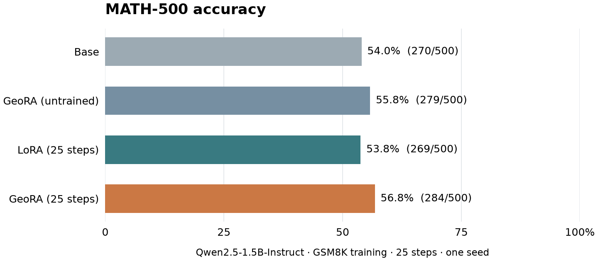
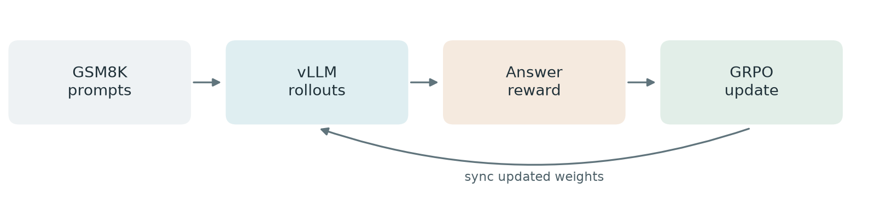

# GeoRA Reproduction

An independent reproduction of [GeoRA: Geometry-Aware Low-Rank Adaptation for RLVR](https://aclanthology.org/2026.acl-long.1110/) (Zhang et al., ACL 2026). We compare GeoRA and LoRA for mathematical reasoning with GRPO.

## Results

Qwen2.5-1.5B-Instruct trained on GSM8K and evaluated on MATH-500. LoRA and GeoRA were trained for 25 steps with one seed.

This is a preliminary comparison; it does not establish a training advantage or reproduce the full paper experiment. [Evaluation details](RESULTS.md).

## Training

The current TRL + vLLM pipeline has passed a two-step GPU training and checkpoint recovery test for both LoRA and GeoRA. This test is separate from the 25-step results above.

- [GeoRA implementation](geora_layers.py)
- [Training code and setup](vllm_modern/README.md)
- [Previous experiment notes](docs/archive/README.md)

The longer comparison is planned but has not started.
